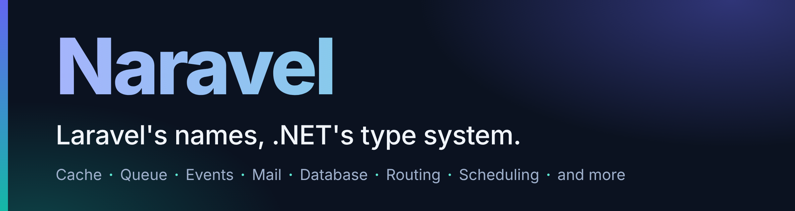

<div align="center">



**کش، صف، رویداد، ایمیل، زمان‌بندی، query builder و بیشتر:**<br>
**واژگان لاراولی که می‌شناسید، در قالب بسته‌های .NET 10 با تایپ قوی، async و تزریق وابستگی.**

[](https://github.com/km-arc/Naravel/actions/workflows/ci.yml)
[](https://www.nuget.org/packages/Naravel.Foundation)
[](https://dotnet.microsoft.com/)
[](LICENSE)

[شروع سریع](#شروع-سریع) · [ماژول‌ها](docs/fa/modules.md) · [مستندات](docs/README.md) · [parity با لاراول](docs/fa/laravel-parity.md) · [CHANGELOG](CHANGELOG.md) · [English](README.md)

</div>

اگر `Cache::remember`، `dispatch(new Job)` و `Route::prefix()->group()` را می‌شناسید، همین حالا می‌توانید Naravel را بخوانید. نام‌ها همان نام‌های لاراول است. متدها `async` هستند، `CancellationToken` می‌گیرند، از تزریق وابستگی می‌آیند و کامپایلر آن‌ها را بررسی می‌کند.

## همان کار، در یک خط

| می‌خواهید | Laravel | Naravel |
|---|---|---|
| مقداری را کش کنید | `Cache::remember('site', 600, fn () => load())` | `await cache.RememberAsync("site", TimeSpan.FromMinutes(10), () => LoadAsync())` |
| jobی را با تأخیر در صف بگذارید | `SendWelcome::dispatch($user)->delay(now()->addMinutes(5))` | `await jobs.DispatchAsync(new SendWelcomeJob(user), o => o.DelayFor(TimeSpan.FromMinutes(5)))` |
| eventای پخش کنید | `event(new OrderPaid($id))` | `await events.DispatchAsync(new OrderPaid(id))` |
| ایمیل بفرستید | `Mail::to($user->email)->send(new WelcomeMail($user))` | `await mailer.To(user.Email).SendAsync(new WelcomeMail(user))` |
| routeها را گروه‌بندی کنید | `Route::prefix('admin')->name('admin.')->group(...)` | `routes.Prefix("admin").Name("admin.").Group(...)` |
| جدولی را query کنید | `DB::table('users')->where('active', true)->orderBy('name')->get()` | `await db.Table("users").Where("active", true).OrderBy("name").GetAsync()` |
| فایلی ذخیره کنید | `Storage::put($path, $contents)` | `await storage.PutAsync(path, contents)` |
| کاری را زمان‌بندی کنید | `$schedule->call(fn () => prune())->everyFiveMinutes()->withoutOverlapping()` | `schedule.Call("prune", (sp, ct) => PruneAsync(ct)).EveryFiveMinutes().WithoutOverlapping()` |

نگاشت کامل، با مشخص‌شدن آنچه Naravel به خود .NET سپرده یا رد کرده، در [جدول parity با لاراول](docs/fa/laravel-parity.md) است.

## شروع سریع

Naravel برای **.NET 10** است. هر ماژول یک بستهٔ NuGet جداست، پس فقط همان‌هایی را اضافه می‌کنید که لازم دارید.

```sh
dotnet new web -n Hello && cd Hello
dotnet add package Naravel.Cache
```

محتوای `Program.cs` را با این جایگزین کنید:

```csharp
using Naravel.Cache;
using Naravel.Cache.Abstractions;

var builder = WebApplication.CreateBuilder(args);
builder.Services.AddNaravelCache(builder.Configuration);   // یک store درون‌حافظه، مگر اینکه store دیگری پیکربندی کنید

var app = builder.Build();
app.MapGet("/", (ICacheStore cache) =>
    cache.RememberAsync("greeting", TimeSpan.FromMinutes(10), () => Task.FromResult($"Hello at {DateTime.UtcNow:T} UTC")));
app.Run();
```

اجرایش کنید و صفحه را دوباره بارگذاری کنید: ساعت ده دقیقه ثابت می‌ماند، چون `RememberAsync` آن را از cache برمی‌گرداند.

اینکه هر بسته چه چیزی می‌دهد و کدام فراخوانی آن را ثبت می‌کند در [شروع کار](docs/fa/getting-started.md) است. اول می‌خواهید یک برنامهٔ کامل را ببینید؟ دستور `dotnet run --project samples/Naravel.Sample/Naravel.Sample.csproj` [برنامهٔ نمونه](samples/Naravel.Sample/README.md) را راه می‌اندازد.

## چرا Naravel

- **نام‌های آشنا، .NET معمولی.** `RememberAsync`، `DelayFor` و `Prefix().Group()`: واژگان لاراول روی متدهایی که `async` هستند، `CancellationToken` می‌گیرند و از تزریق وابستگی می‌آیند.
- **فقط آنچه لازم دارید را نصب کنید.** برای هر ماژول و هر provider یک بستهٔ NuGet جدا، همه با یک نسخه. Redis می‌شود `Naravel.Cache.Redis` و وابستگیِ همه نیست.
- **اول بومی، با صراحت.** Naravel یک ایدهٔ لاراولی را فقط وقتی می‌پذیرد که نسبت به امکانات خود .NET ارزش عملی اضافه کند. session، هش گذرواژه و مجوزدهی route از قبل در ASP.NET Core و .NET هست، پس به‌جای بسته، دستورالعمل مستند می‌دهد (PDR-015، PDR-016، PDR-019)؛ جایی هم که بسته اضافه می‌کند، یک PDR دلیلش را ثبت می‌کند.
- **صادق دربارهٔ تضمین‌ها.** jobهای صف at-least-once هستند و باید idempotent باشند؛ Kafka تحویل با تأخیر را رد می‌کند؛ throttle در routeها فقط در یک پردازه اعمال می‌شود. محدودیت‌ها کنار قابلیت‌ها نوشته شده‌اند، نه اینکه در production کشف شوند.
- **fake برای تست، بدون global state.** ماژول‌های Cache، Events، Mail، Notifications، Queue، Filesystem، Broadcasting، Database و Scheduling هرکدام یک fake دارند (`MailFake`، `QueueFake`، `StorageFake`...) که مثل هر وابستگی دیگر به کد می‌دهید و رویش assert می‌کنید، بدون broker، mail server، دیسک، bucket یا پایگاه داده.
- **مستند به دو زبان فارسی و انگلیسی.** هر راهنما و هر تصمیم طراحی به هر دو زبان نوشته شده است.

```csharp
var fake = new MailFake { DefaultFrom = "app@example.com" };
await new SignupService(fake).RegisterAsync("ada@example.com");   // کد شما؛ یک IMailer می‌گیرد

fake.AssertSent(m => m.To.Contains("ada@example.com") && m.Subject == "Welcome");
fake.AssertNothingQueued();
```

## ماژول‌ها

هر ماژول راهنمایی با یک مثال کوتاه و تضمین‌هایی که باید بدانید دارد. بسته‌های provider اختیاری‌اند و فقط برای storeها و driverهایی هستند که استفاده می‌کنید.

| ماژول | چه چیزی می‌دهد | بسته‌های اختیاری |
|---|---|---|
| [`Naravel.Cache`](docs/fa/cache.md) | storeهای نام‌دار، `RememberAsync`، tag، lock توکنی، rate limiter | `.Redis`، `.Memcached` |
| [`Naravel.Queue`](docs/fa/queue.md) | jobهای پس‌زمینه: تأخیر، اولویت، retry و backoff، زنجیره، batch، worker میزبانی‌شده | driverهای `.Memory` `.File` `.Redis` `.Database` `.RabbitMQ` `.Kafka`؛ `.Coordination`، `.Encryption` |
| [`Naravel.Events`](docs/fa/events.md) | رویدادها و listenerهای تایپ‌شدهٔ درون‌فرایندی | `.Queue` برای listenerهای صف‌شده |
| [`Naravel.Mail`](docs/fa/mail.md) | کلاس‌های `Mailable`، transportهای log و array و SMTP، `MailFake` | `.Smtp`، `.Queue` |
| [`Naravel.Notifications`](docs/fa/notifications.md) | یک اعلان از راه channelهایی که نام می‌برید، به همان ترتیب | `.Mail`، `.Queue` |
| [`Naravel.Database`](docs/fa/database.md) | query builder با پارامتر bind‌شده روی SQLite، MySQL، PostgreSQL و SQL Server؛ تراکنش | dialectهای `.Sqlite` `.MySql` `.Postgres` `.SqlServer`؛ `.EntityFrameworkCore` |
| [`Naravel.Pagination`](docs/fa/pagination.md) | صفحه‌هایی با شکل Laravel: کامل، ساده و cursor | `.EntityFrameworkCore` |
| [`Naravel.Filesystem`](docs/fa/filesystem.md) | دیسک‌های نام‌دار local و سازگار با S3 | ندارد |
| [`Naravel.Routing`](docs/fa/routing.md) | گروه مسیر، نام مسیر، resource route و route middleware روی ASP.NET Core | ندارد |
| [`Naravel.Scheduling`](docs/fa/scheduling.md) | کارهای زمان‌بندی‌شده در یک hosted service، با `WithoutOverlapping` و `OnOneServer` | ندارد |
| [`Naravel.Broadcasting`](docs/fa/broadcasting.md) | رویدادهای بلادرنگ تایپ‌دار روی SignalR، با مجوزدهی کانال | ندارد |
| [`Naravel.Encryption`](docs/fa/encryption.md) | `Encrypt` و `Decrypt` روی ASP.NET Core Data Protection | ندارد |
| [`Naravel.Redis`](docs/fa/redis.md) | اتصال‌های Redis نام‌دار و مشترک | ندارد |
| [`Naravel.Foundation`](docs/fa/foundation.md) | پایهٔ مدیریت driver که بقیه روی آن ساخته شده‌اند | خودکار نصب می‌شود |

بسته نیست، عمداً: session، هش گذرواژه و مجوزدهی route از قبل بخشی از ASP.NET Core و .NET هستند و راهنماها دستورالعملشان را نشان می‌دهند ([session](docs/fa/session.md)، [auth](docs/fa/auth.md)، [hashing](docs/fa/hashing.md)). مثال‌های همهٔ ماژول‌ها در [ماژول‌ها](docs/fa/modules.md) یک‌جا جمع شده است.

## وضعیت

> **نسخهٔ 0.x (پیش از 1.0).** API عمومی ممکن است بین نسخه‌های minor عوض شود؛ هر تغییر ناسازگار در [CHANGELOG](CHANGELOG.md) فهرست می‌شود (OD-09). Jobهای صف «دست‌کم یک‌بار» (at-least-once) اجرا می‌شوند. هنوز هیچ بسته‌ای سازگاری با trim یا Native AOT را اعلام نکرده است ([docs/fa/trimming-aot.md](docs/fa/trimming-aot.md)). اول روی یک شاخهٔ آزمایشی امتحانش کنید و تضمین‌های کنار هر قابلیت را بخوانید.

**وضعیت ماژول‌ها و نقشه‌راه:** مرجع رسمی [ROADMAP.md](ROADMAP.md) است. نتیجهٔ build و test در [GitHub Actions](https://github.com/km-arc/Naravel/actions/workflows/ci.yml) گزارش می‌شود.

## مستندات

| | |
|---|---|
| [شروع کار](docs/fa/getting-started.md) | کدام بسته را نصب کنیم، کدام فراخوانی آن را ثبت می‌کند، برنامهٔ نمونه |
| [ماژول‌ها](docs/fa/modules.md) | هر ماژول با یک مثال و تضمین‌هایش |
| [راهنماها](docs/fa) | برای هر ماژول یک راهنمای کامل، هرکدام با [نسخهٔ انگلیسی](docs/en) |
| [parity با لاراول](docs/fa/laravel-parity.md) و [PDRها](docs/pdr/fa) | چه چیزی منتقل، تطبیق داده یا رد شد و چرا |
| [معماری](docs/fa/architecture.md)، [benchmarkها](docs/fa/benchmarks.md) | ماژول‌ها چطور ساخته شده‌اند و چه هزینه‌ای دارند |
| [فهرست مستندات](docs/README.md) | همهٔ موارد بالا به فارسی و انگلیسی |

## مشارکت

مشارکت شما پذیرفته است: [CONTRIBUTING.fa.md](CONTRIBUTING.fa.md) و [آیین‌نامهٔ رفتار](CODE_OF_CONDUCT.fa.md) را بخوانید. پرسش و گزارش باگ در [GitHub issues](https://github.com/km-arc/Naravel/issues) است؛ مشکل امنیتی را طبق [SECURITY.md](SECURITY.md) گزارش کنید. قواعد مشارکت‌کنندگان و ایجنت‌ها در [AGENTS.md](AGENTS.md) است.

Naravel با [مجوز MIT](LICENSE) منتشر شده است.
