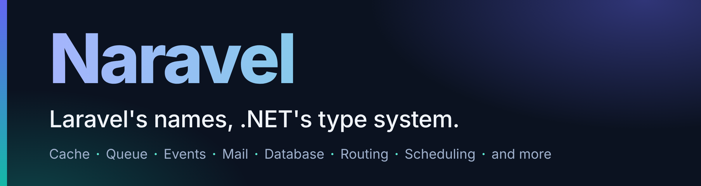

<div align="center">



**Cache, queue, events, mail, scheduling, a query builder and more:**<br>
**the Laravel vocabulary you already know, as typed, async, dependency-injected .NET 10 packages.**

[](https://github.com/km-arc/Naravel/actions/workflows/ci.yml)
[](https://www.nuget.org/packages/Naravel.Foundation)
[](https://dotnet.microsoft.com/)
[](LICENSE)

[Get started](#get-started) · [Modules](#modules) · [Documentation](docs/README.md) · [Laravel parity](docs/en/laravel-parity.md) · [Changelog](CHANGELOG.md) · [فارسی](README.fa.md)

</div>

If you know `Cache::remember`, `dispatch(new Job)` and `Route::prefix()->group()`, you can already read Naravel. The names are Laravel's. The methods are `async`, take a `CancellationToken`, come from dependency injection and are checked by the compiler.

## Same job, one line each

| You want to | Laravel | Naravel |
|---|---|---|
| Remember a value | `Cache::remember('site', 600, fn () => load())` | `await cache.RememberAsync("site", TimeSpan.FromMinutes(10), () => LoadAsync())` |
| Queue a delayed job | `SendWelcome::dispatch($user)->delay(now()->addMinutes(5))` | `await jobs.DispatchAsync(new SendWelcomeJob(user), o => o.DelayFor(TimeSpan.FromMinutes(5)))` |
| Dispatch an event | `event(new OrderPaid($id))` | `await events.DispatchAsync(new OrderPaid(id))` |
| Send mail | `Mail::to($user->email)->send(new WelcomeMail($user))` | `await mailer.To(user.Email).SendAsync(new WelcomeMail(user))` |
| Group routes | `Route::prefix('admin')->name('admin.')->group(...)` | `routes.Prefix("admin").Name("admin.").Group(...)` |
| Query a table | `DB::table('users')->where('active', true)->orderBy('name')->get()` | `await db.Table("users").Where("active", true).OrderBy("name").GetAsync()` |
| Store a file | `Storage::put($path, $contents)` | `await storage.PutAsync(path, contents)` |
| Schedule a task | `$schedule->call(fn () => prune())->everyFiveMinutes()->withoutOverlapping()` | `schedule.Call("prune", (sp, ct) => PruneAsync(ct)).EveryFiveMinutes().WithoutOverlapping()` |

The full mapping, including what Naravel leaves to .NET and what it rejects, is the [Laravel parity table](docs/en/laravel-parity.md).

## Get started

Naravel targets **.NET 10**. Every module is its own NuGet package, so you add only what you use.

```sh
dotnet new web -n Hello && cd Hello
dotnet add package Naravel.Cache
```

Replace `Program.cs` with:

```csharp
using Naravel.Cache;
using Naravel.Cache.Abstractions;

var builder = WebApplication.CreateBuilder(args);
builder.Services.AddNaravelCache(builder.Configuration);   // an in-memory store unless you configure another

var app = builder.Build();
app.MapGet("/", (ICacheStore cache) =>
    cache.RememberAsync("greeting", TimeSpan.FromMinutes(10), () => Task.FromResult($"Hello at {DateTime.UtcNow:T} UTC")));
app.Run();
```

Run it and reload the page: the time stays the same for ten minutes, because `RememberAsync` serves it from the cache.

Which package gives you what, and which call registers it, is in [Getting started](docs/en/getting-started.md). Prefer to see a whole app first? `dotnet run --project samples/Naravel.Sample/Naravel.Sample.csproj` starts the [sample app](samples/Naravel.Sample/README.md).

## Why Naravel

- **Familiar names, ordinary .NET.** `RememberAsync`, `DelayFor`, `Prefix().Group()`: Laravel's vocabulary on methods that are `async`, take a `CancellationToken` and come from dependency injection.
- **Install only what you use.** One NuGet package per module and per provider, all on one version. Redis is `Naravel.Cache.Redis`, not a dependency of everyone.
- **Native first, said out loud.** Naravel adopts a Laravel idea only when it adds practical value beyond what .NET already provides. Sessions, password hashing and route authorization already exist in ASP.NET Core and .NET, so it documents the recipe instead of shipping a package (PDR-015, PDR-016, PDR-019); where it does add a package, a PDR records why.
- **Honest about guarantees.** Queue jobs are at-least-once and should be idempotent; Kafka rejects delayed dispatch; route throttling is process-local. The limits are written next to the features instead of being discovered in production.
- **Fakes for tests, no global state.** Cache, Events, Mail, Notifications, Queue, Filesystem, Broadcasting, Database and Scheduling each ship a fake (`MailFake`, `QueueFake`, `StorageFake`...) that you pass in like any other dependency and assert on, without a broker, mail server, disk, bucket or database.
- **Documented in English and Persian.** Every guide and every design decision exists in both languages.

```csharp
var fake = new MailFake { DefaultFrom = "app@example.com" };
await new SignupService(fake).RegisterAsync("ada@example.com");   // your code; it takes an IMailer

fake.AssertSent(m => m.To.Contains("ada@example.com") && m.Subject == "Welcome");
fake.AssertNothingQueued();
```

## Modules

Each module has a guide with a short example and the guarantees worth knowing. Provider packages are optional and only for the stores and drivers you use.

| Module | What you get | Optional packages |
|---|---|---|
| [`Naravel.Cache`](docs/en/cache.md) | Named stores, `RememberAsync`, tags, token-owned locks, a rate limiter | `.Redis`, `.Memcached` |
| [`Naravel.Queue`](docs/en/queue.md) | Background jobs: delay, priority, retries and backoff, chains, batches, hosted workers | drivers `.Memory` `.File` `.Redis` `.Database` `.RabbitMQ` `.Kafka`; `.Coordination`, `.Encryption` |
| [`Naravel.Events`](docs/en/events.md) | Typed in-process events and listeners | `.Queue` for queued listeners |
| [`Naravel.Mail`](docs/en/mail.md) | `Mailable` classes, log, array and SMTP transports, `MailFake` | `.Smtp`, `.Queue` |
| [`Naravel.Notifications`](docs/en/notifications.md) | One notification, sent through the channels you name, in the order you name them | `.Mail`, `.Queue` |
| [`Naravel.Database`](docs/en/database.md) | A query builder with bound parameters on SQLite, MySQL, PostgreSQL and SQL Server; transactions | dialects `.Sqlite` `.MySql` `.Postgres` `.SqlServer`; `.EntityFrameworkCore` |
| [`Naravel.Pagination`](docs/en/pagination.md) | Laravel-shaped pages: length-aware, simple and cursor | `.EntityFrameworkCore` |
| [`Naravel.Filesystem`](docs/en/filesystem.md) | Named local and S3-compatible disks | none |
| [`Naravel.Routing`](docs/en/routing.md) | Route groups, names, resource routes and route middleware on ASP.NET Core | none |
| [`Naravel.Scheduling`](docs/en/scheduling.md) | Scheduled tasks in a hosted service, with `WithoutOverlapping` and `OnOneServer` | none |
| [`Naravel.Broadcasting`](docs/en/broadcasting.md) | Typed real-time events over SignalR, with channel authorization | none |
| [`Naravel.Encryption`](docs/en/encryption.md) | `Encrypt` and `Decrypt` over ASP.NET Core Data Protection | none |
| [`Naravel.Redis`](docs/en/redis.md) | Named, shared Redis connections | none |
| [`Naravel.Foundation`](docs/en/foundation.md) | The driver-manager base the others build on | installed for you |

Not a package, on purpose: sessions, password hashing and route authorization are already ASP.NET Core and .NET features, and the guides show the recipe ([session](docs/en/session.md), [auth](docs/en/auth.md), [hashing](docs/en/hashing.md)). Examples for every module are collected in [Modules](docs/en/modules.md).

## Status

> **0.x (pre-1.0).** The public API can still change between minor versions; every breaking change is listed in the [CHANGELOG](CHANGELOG.md) (OD-09). Queue jobs are at-least-once. No package declares trim or Native AOT compatibility yet ([docs/en/trimming-aot.md](docs/en/trimming-aot.md)). Try it on a branch first and read the guarantees next to each feature.

[ROADMAP.md](ROADMAP.md) is the source of truth for module and roadmap status. Build and test results are reported by [GitHub Actions](https://github.com/km-arc/Naravel/actions/workflows/ci.yml).

## Documentation

| | |
|---|---|
| [Getting started](docs/en/getting-started.md) | Which package to install, which call registers it, the sample app |
| [Modules](docs/en/modules.md) | Every module with an example and its guarantees |
| [Guides](docs/en) | One in-depth guide per module, each with a [Persian twin](docs/fa) |
| [Laravel parity](docs/en/laravel-parity.md) and [PDRs](docs/pdr/en) | What was ported, adapted or declined, and why |
| [Architecture](docs/en/architecture.md), [benchmarks](docs/en/benchmarks.md) | How the modules are built and what they cost |
| [Documentation index](docs/README.md) | Everything above in English and Persian |

## Contributing

Contributions are welcome: read [CONTRIBUTING.md](CONTRIBUTING.md) and the [Code of Conduct](CODE_OF_CONDUCT.md). Questions and bugs go to [GitHub issues](https://github.com/km-arc/Naravel/issues); security problems follow [SECURITY.md](SECURITY.md). Contributor and agent rules are in [AGENTS.md](AGENTS.md).

Naravel is released under the [MIT license](LICENSE).
